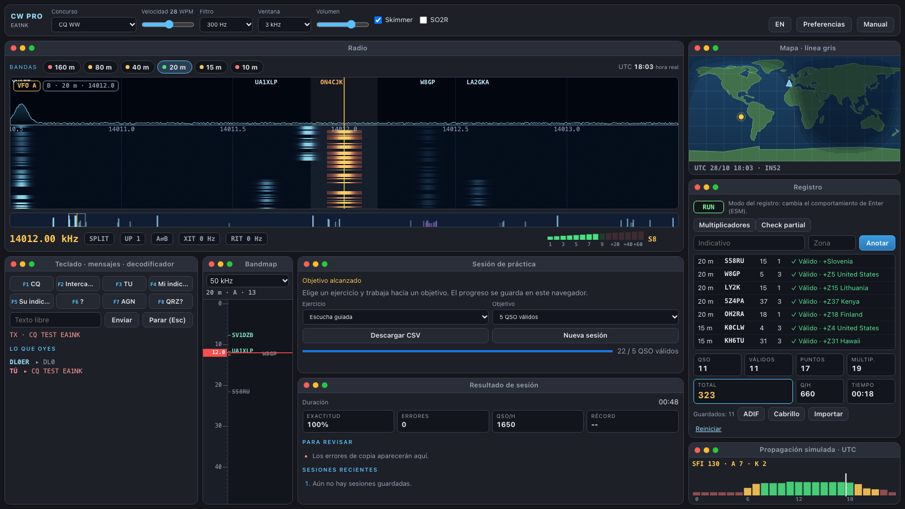
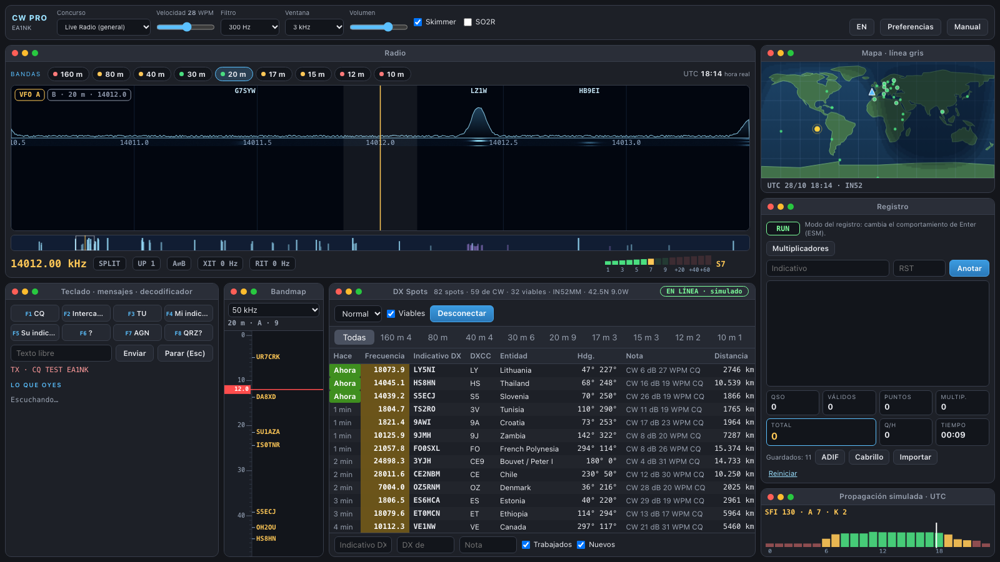
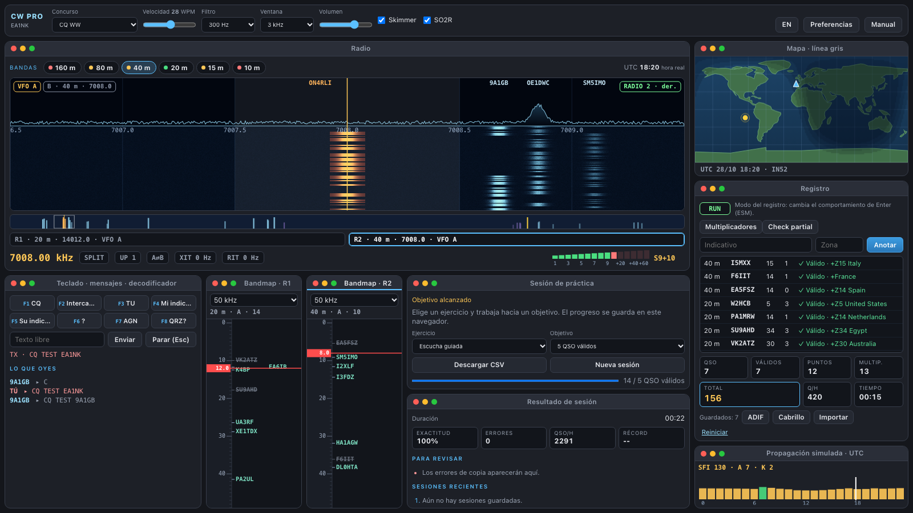
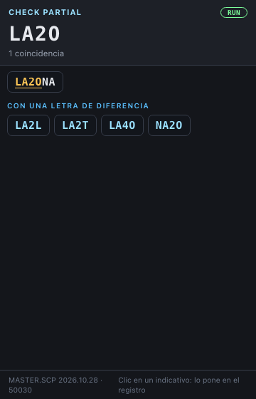
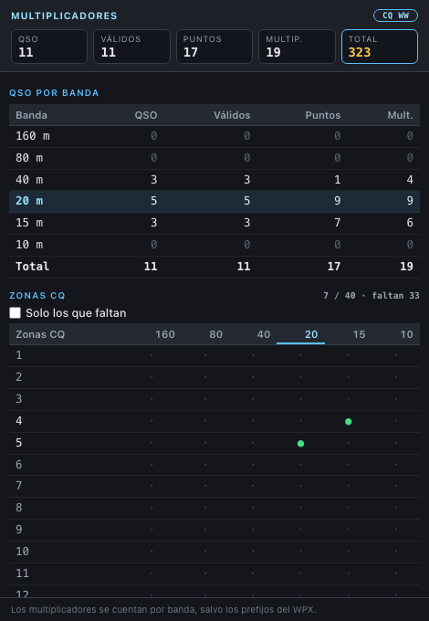
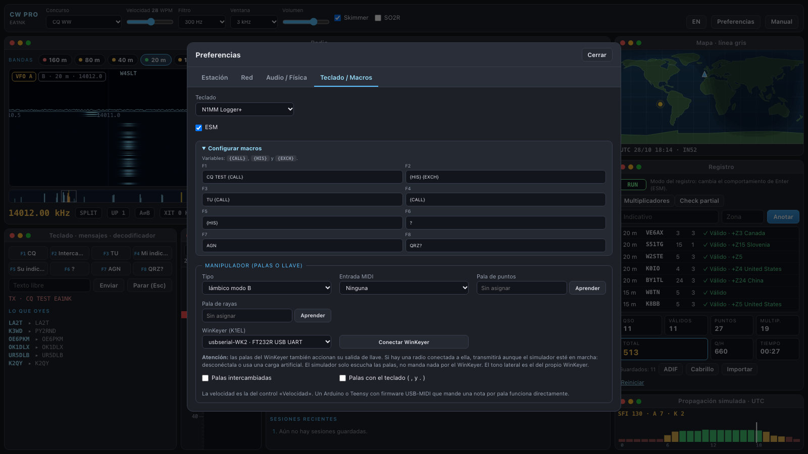
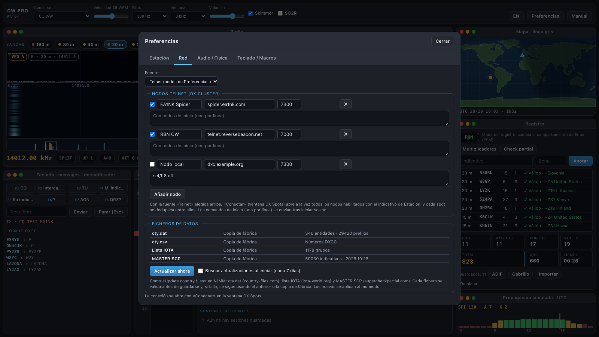
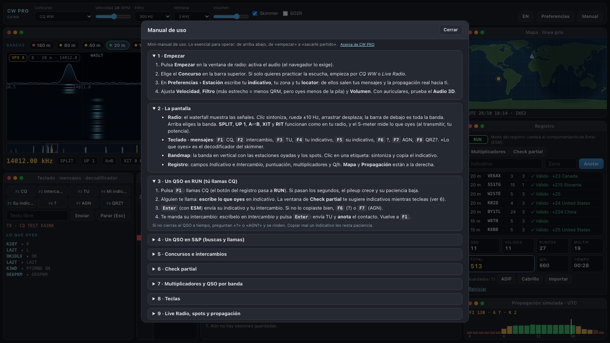

# Simulador de Concursos CW — CW PRO

[🇬🇧 English](README.md) · **🇪🇸 Castellano**

**Practica concursos de telegrafía y operación diaria en HF sin radio, sin antena y sin banda.**
CW PRO es un simulador de escritorio de [EA1NK](https://github.com/ea1nk) que te sienta en la silla de una estación de concurso: un waterfall lleno de estaciones, pileups que te llaman, intercambios reales, una propagación que sigue al sol y un log que se comporta como los que usas en el aire.



## Descarga

Baja el instalador de tu sistema en la página de **[Releases](https://github.com/ea1nk/cw-simulator/releases)**:

| Sistema | Archivo |
| --- | --- |
| macOS (Apple Silicon e Intel) | `.dmg` |
| Windows 10 / 11 | `.msi` o `.exe` |
| Linux | `.AppImage`, `.deb` o `.rpm` |

De momento los instaladores no están firmados:

- **macOS** — Apple no ha notarizado la aplicación, así que el primer arranque se bloquea. Cópiala a *Aplicaciones* y haz una de estas dos cosas:
  - abre **Ajustes del Sistema › Privacidad y seguridad** y pulsa **Abrir igualmente** (macOS 15), o clic derecho sobre la aplicación → **Abrir** (macOS 13–14); o
  - ejecuta esto una vez en Terminal, que quita la marca de cuarentena de la descarga (la opción más fiable, y la que hay que usar si macOS dice que la aplicación está *«dañada»*):
    ```
    xattr -cr "/Applications/CW Contest Simulator.app"
    ```
- **Windows** — SmartScreen puede avisarte: elige **Más información → Ejecutar de todas formas**.

Necesitas macOS 13 o posterior, Windows con WebView2 (incluido en Windows 11) o un escritorio Linux con WebKitGTK. No hace falta conexión para usarlo; solo se usa para los spots reales del DX Cluster, el clima espacial real y las actualizaciones de datos.

## Qué puedes hacer

### Hacer concursos
Siete modos de operación, cada uno con su intercambio, puntuación y multiplicadores:

| Modo | De qué va |
| --- | --- |
| **CQ WW** | 5NN + zona CQ; zonas y países como multiplicadores |
| **CQ WPX** | 5NN + número de serie; prefijos como multiplicadores |
| **ARRL DX CW** | Los DX envían potencia; los W/VE, estado o provincia |
| **CNCW** | 5NN + provincia, con la estación HQ |
| **IOTA Contest** | Número de serie + referencia IOTA, con la lista completa de ~1.180 grupos de islas |
| **DXpedition** | Tú eres el DX raro: atiende un pileup que se impacienta |
| **Live Radio** | Operación general con spots DX reales; un multiplicador por país y banda |

Y un **entrenador de pila de indicativos** para copiar varias estaciones que llaman a la vez.

### RUN y buscar y llamar
- **RUN**: llama CQ con F1 y atiende a los que te llaman uno a uno. El pileup crece, se impacienta, pregunta «?» o «AGN?» y se marcha si tardas.
- **S&P**: haz clic en una estación del waterfall, del bandmap o de un spot, y llámala.
- El **QRM** humano (alguien sintonizando encima, «QRL?»), los que te llaman pisándote y las estaciones que solo contestan si envías **tu** indicativo te mantienen alerta.

### Opera como en tu logger favorito
- Atajos de **N1MM Logger+** y **Win-Test**, **ESM** (Enter envía lo que toca según el campo) y macros F1–F8 editables.
- Split, XIT, RIT, UP 1, A⇄B y dos VFO por radio, y operación **SO2R** completa con dos radios (más abajo).
- Un **skimmer** que decodifica indicativos y pinta en el bandmap las estaciones que llaman CQ; apágalo para copiar por oído.



### SO2R: dos radios, dos oídos
Opera con **dos radios a la vez**, como en una estación de concurso multibanda (Single Operator, Two Radios):
- Cada radio tiene **su banda, su VFO, su filtro y su split**, y su propio bandmap. La radio 1 suena por el **oído izquierdo** y la radio 2 por el **derecho** (con auriculares).
- Cambia de radio con la tira **R1 / R2**, la tecla `Pausa` (estilo N1MM) o `Alt-1` / `Alt-2` (estilo Win-Test). Transmites por la radio que tiene el foco mientras la otra sigue escuchando: así puedes **buscar en una mientras haces RUN en la otra**.
- El registro, los repetidos y los multiplicadores son comunes a las dos radios.



### Escúchalo como suena
- Waterfall y S-meter, filtros de 2000 a 150 Hz y bandmap.
- **Audio 3D**: cada estación se coloca en el espacio según su frecuencia (con auriculares).
- Sabor real de HF: **chirp**, **aurora flutter** y **fading selectivo** (multitrayecto), y niveles de dificultad de *Easy* a *Insane*.

### Propagación real
- Las bandas siguen la **hora UTC real** y **tu locator**: zonas de silencio, absorción de la capa D de día, 160 y 80 m que abren de noche y línea gris en el mapa.
- Elige una actividad solar (pobre, normal, excelente, tormenta geomagnética) o usa el **clima espacial real de la NOAA** (índices SFI, A y K y alertas de tormenta).
- **Spots de CW reales** del **Reverse Beacon Network** por Telnet, nada más abrirlo. Añade más nodos de clúster y conéctate a varios a la vez (versión de escritorio).

### Check partial y multiplicadores, como en los programas de verdad
- **Check partial** en su propia ventana flotante, que puedes llevar a una segunda pantalla. Usa la base real **MASTER.SCP**: escribe parte de un indicativo y verás las coincidencias, los que difieren en una letra y tus repetidos tachados. Un clic lo pone en el registro.
- Ventana de **multiplicadores y QSO por banda**: QSO, puntos y multiplicadores de cada banda, las zonas, países, secciones o provincias que has trabajado y **los que te faltan**.

| Check partial | Multiplicadores y QSO por banda |
| :---: | :---: |
|  |  |

### Guarda tu registro
- Cada contacto se guarda. **Exporta a ADIF y Cabrillo 3.0** e importa ADIF.
- **Sesiones de práctica** con objetivo, exactitud, errores, QSO por hora y lista de lo que repasar; descarga el registro en CSV.

### Datos siempre al día
- **cty.dat** (ficheros de países), la lista **IOTA** completa y **MASTER.SCP** vienen incluidos y se actualizan desde *Preferencias* con un clic, como «Update country files» en N1MM.

### Tu llave, tus palas
- Usa un **WinKeyer de K1EL**: sus palas y su mando de velocidad gobiernan el simulador.
- O una llave USB-MIDI (Arduino, Teensy…) con keyer iámbico integrado (modos A y B) o una llave vertical.



### En castellano o en inglés
Cambia la interfaz entre **castellano** e **inglés** en cualquier momento con el botón **EN / ES**. Lleva un **mini-manual** con lo esencial y una tabla de teclas.

| Preferencias | Manual |
| :---: | :---: |
|  |  |

## Empezar en un minuto

1. Abre la aplicación y pulsa **Empezar** en la ventana de radio.
2. En **Preferencias › Estación** escribe tu indicativo y tu locator.
3. Elige un concurso, pulsa **F1** para llamar CQ, escribe lo que oyes y pulsa **Enter**.

¡73 y buenos concursos! — **EA1NK**

---

*¿Dudas o ideas? Abre una [incidencia](https://github.com/ea1nk/cw-simulator/issues).*
