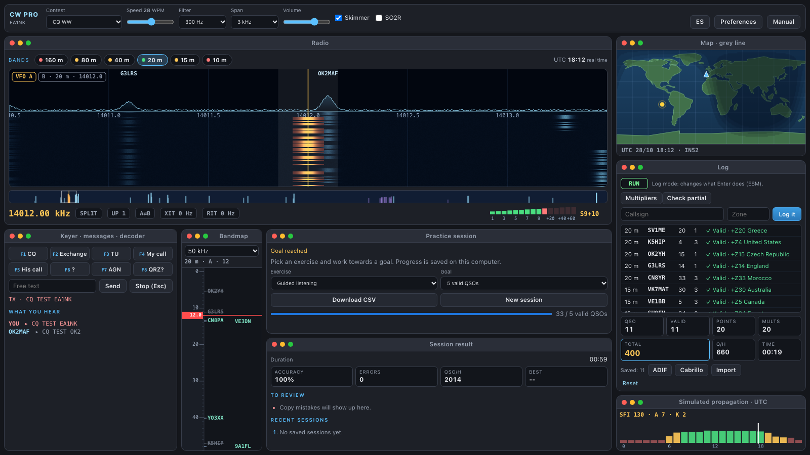
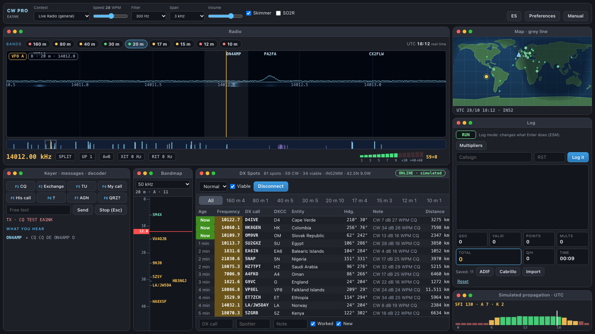
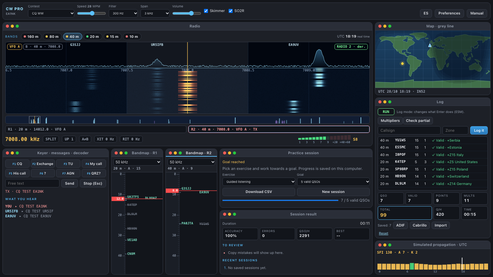
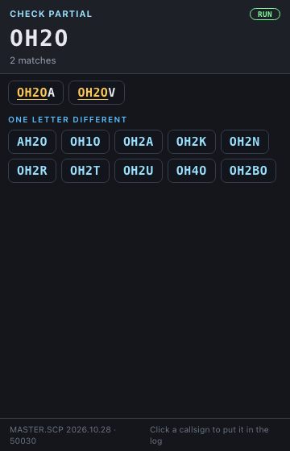
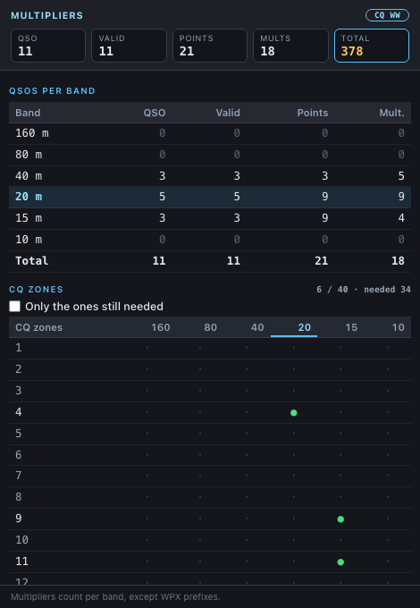
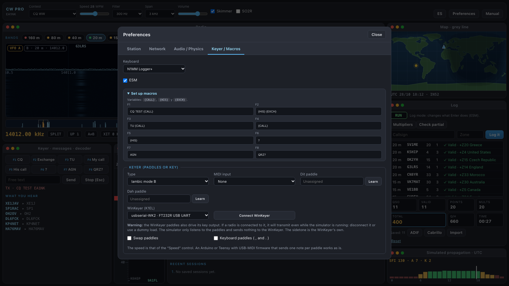
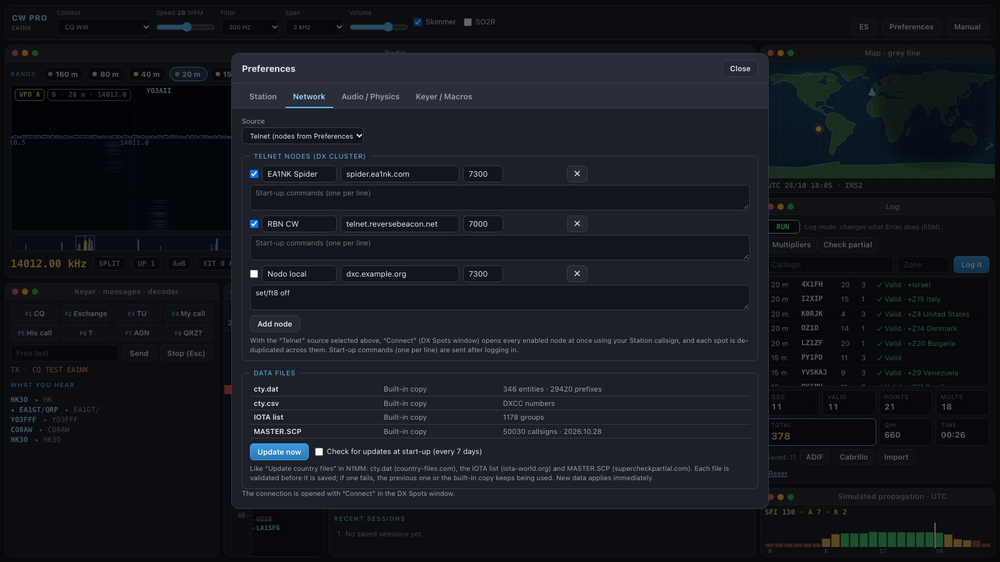
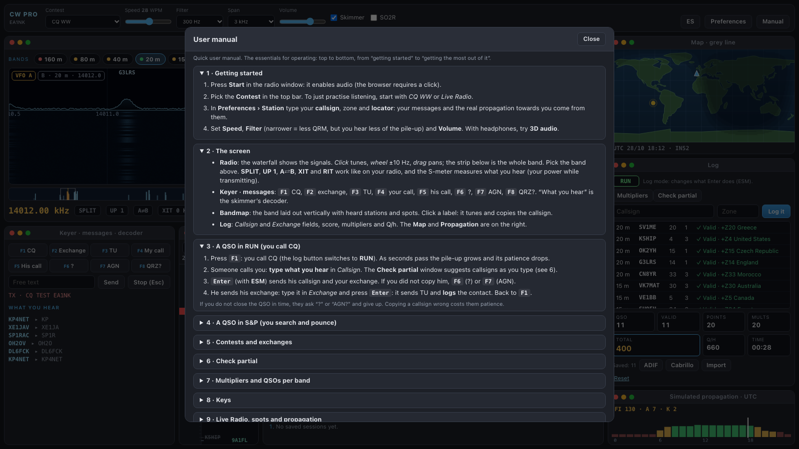

# CW Contest Simulator — CW PRO

**🇬🇧 English** · [🇪🇸 Castellano](LEEME.md)

**Practise CW contesting and everyday HF operating without a radio, an antenna or a band.**
CW PRO is a desktop simulator by [EA1NK](https://github.com/ea1nk) that puts you in the chair of a contest station: a waterfall full of stations, pile-ups that call you, real contest exchanges, propagation that follows the sun, and a logger that behaves like the ones you use on the air.

## Download

Get the installer for your system from the **[Releases](https://github.com/ea1nk/cw-simulator/releases)** page:

| System | File |
| --- | --- |
| macOS (Apple Silicon and Intel) | `.dmg` |
| Windows 10 / 11 | `.msi` or `.exe` |
| Linux | `.AppImage`, `.deb` or `.rpm` |

The installers are not code-signed yet:

- **macOS** — the first time, right-click the app and choose **Open** (or run `xattr -cr "CW Contest Simulator.app"`).
- **Windows** — SmartScreen may warn you: choose **More info → Run anyway**.

You need macOS 13 or later, Windows with WebView2 (included in Windows 11), or a Linux desktop with WebKitGTK. No internet connection is needed to use it; it is only used for live DX spots, real space weather and data updates.

## What you can do

### Work contests
Seven operating modes, each with its own exchange, scoring and multipliers:

| Mode | What it is |
| --- | --- |
| **CQ WW** | 5NN + CQ zone, zones and countries as multipliers |
| **CQ WPX** | 5NN + serial number, prefixes as multipliers |
| **ARRL DX CW** | DX stations send power; W/VE send state or province |
| **CNCW** | 5NN + province, with the HQ station |
| **IOTA Contest** | Serial number + IOTA reference, from the full list of ~1,180 island groups |
| **DXpedition** | You are the rare DX: handle a pile-up that gets impatient |
| **Live Radio** | General operating with real DX spots, one multiplier per country and band |

Plus a **callsign pile-up trainer** for copying several stations calling at once.

### Run and search & pounce
- **RUN**: call CQ with F1 and answer the callers one by one. A pile-up builds up, gets impatient, asks "?" or "AGN?" and leaves if you take too long.
- **S&P**: click a station on the waterfall, the bandmap or a spot, and call it.
- Human **QRM** (someone tuning up on your frequency, "QRL?"), operators who call over you, and stations that only answer when you send **your** callsign keep you on your toes.

### Operate like in your favourite logger
- **N1MM Logger+** and **Win-Test** key bindings, **ESM** (Enter sends what fits the field), macros F1–F8 you can edit.
- Split, XIT, RIT, UP 1, A⇄B and two VFOs per radio, and full **SO2R** operation with two radios (see below).
- A **skimmer** that decodes callsigns and paints the stations calling CQ on the bandmap; switch it off to copy by ear.

### SO2R: two radios, two ears
Run **two radios at once** like a real multi-band contest station (Single Operator, Two Radios):
- Each radio has its **own band, VFO, filter and split**, and its own bandmap. Radio 1 plays in your **left ear**, radio 2 in your **right** (use headphones).
- Switch radios with the **R1 / R2** strip, the `Pause` key (N1MM style) or `Alt-1` / `Alt-2` (Win-Test style). You transmit on the radio that has the focus while the other one keeps listening, so you can **search on one while you run on the other**.
- The log, the dupes and the multipliers are shared between both radios.

### Hear it as it sounds
- A waterfall and S-meter, bandwidth filters from 2000 down to 150 Hz, and a band map.
- **3D audio**: each station is placed in space by its frequency (use headphones).
- Real HF flavour: **chirp**, **aurora flutter** and **selective fading** (multipath), plus difficulty levels from *Easy* to *Insane*.

### Real propagation
- The bands follow the **real UTC time** and **your locator**: skip zones, D-layer absorption by day, 160 m and 80 m opening at night, grey line on the map.
- Choose a solar mode (poor, normal, excellent, geomagnetic storm) or use **live NOAA space weather** (SFI, A and K indices and storm alerts).
- **Real CW spots** from the **Reverse Beacon Network** over Telnet, out of the box. Add more cluster nodes and connect to several at once (desktop version).

### Check partial and multipliers, like the real thing
- **Check partial** in its own floating window — drag it to a second screen. It uses the real **MASTER.SCP** database: type part of a callsign and see the matches, the ones one letter away, and your dupes struck through. Click one to put it in the log.
- **Multipliers and QSOs per band** window: QSOs, points and multipliers for each band, the zones, countries, sections or provinces you have worked, and **the ones you still need**.

| Check partial | Multipliers and QSOs per band |
| :---: | :---: |
|  |  |

### Keep your log
- Every contact is saved. **Export to ADIF and Cabrillo 3.0**, and import ADIF.
- **Practice sessions** with a goal, accuracy, errors, QSOs per hour and a list of what to review; download the log as CSV.

### Up to date data
- **cty.dat** (country files), the full **IOTA** list and **MASTER.SCP** are built in, and you can update them from *Preferences* with one click, just like "Update country files" in N1MM.

### Your key, your paddles
- Use a **K1EL WinKeyer**: its paddles and speed knob drive the simulator.
- Or a USB-MIDI key (Arduino, Teensy…) with a built-in iambic keyer (modes A and B) or a straight key.

### English or Castellano
Switch the interface between **English** and **Spanish** at any moment with the **EN / ES** button. There is a built-in **quick manual** with the essentials and a key table.

| Preferences | Manual |
| :---: | :---: |
|  |  |

## Getting started in one minute

1. Open the app and press **Start** on the radio window.
2. In **Preferences › Station** enter your callsign and locator.
3. Pick a contest, press **F1** to call CQ, type what you hear and press **Enter**.

73 and good contesting! — **EA1NK**

---

*Questions or ideas? Open an [issue](https://github.com/ea1nk/cw-simulator/issues).*
